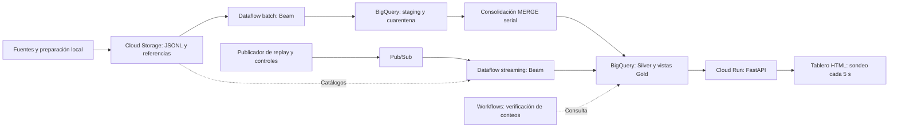

# Guía técnica de incorporación a DataLandia / Lumina

Esta es la puerta de entrada para quien no conoce el proyecto. Explica su evolución, los datos,
el procesamiento, el aprovisionamiento y la demostración final. Las guías enlazadas contienen
los procedimientos detallados y el código es la referencia para las reglas implementadas.

Corte documental: **20 de noviembre de 2026**. Este resumen se contrastó con el repositorio y
sus evidencias guardadas; no se iniciaron servicios ni se consultó nuevamente GCP al redactarlo.
Los resultados históricos no representan el estado instantáneo de las tablas o los jobs.

## 1. Qué problema aborda y qué entrega

**DataLandia** es el escenario académico de integración de datos. **Lumina** es el caso de
movilidad que consume esa integración: combinar viajes históricos, mediciones de sensores y
contexto territorial para consultar actividad, calidad y métricas por zona y periodo.

El resultado es un prototipo con dos implementaciones: una local, que permitió desarrollar las
transformaciones, y otra en GCP, que demuestra procesamiento y exposición hacia un tablero.
La demo final publica eventos, los procesa en Dataflow, los guarda en BigQuery y muestra su
aparición automática a través de una API. También permite inspeccionar rechazos y conflictos.
No se implementó un optimizador de rutas ni se midieron ahorros operativos del negocio.

Las fuentes proceden de ciudades y años diferentes. Sus asociaciones territoriales y el
desplazamiento de fechas son **simulados con fines académicos**. No deben interpretarse como
una integración geográfica real ni como observaciones actuales de sensores físicos.

## 2. Cómo evolucionó el proyecto

| Etapa | Trabajo realizado | Dónde entenderlo |
|---|---|---|
| ETL medallón inicial | Limpieza, homologación de unidades y fuentes, agregados horarios y escenarios analíticos con Spark. Puede generar auxiliares sintéticos si faltan. | [etl_medallion.py](../pipelines/local/etl_medallion.py) |
| Puentes e integración | Lectura de las fuentes disponibles, puentes territoriales, replay de sensores y cruce analítico en ventanas de cinco minutos. | [puentes_batch_streaming.py](../pipelines/local/puentes_batch_streaming.py) |
| P2 local | Batch con DuckDB, streaming por archivos con Spark Structured Streaming, checkpoint y persistencia en SQLite. | [Ejecución local](ejecucion_local.md) |
| Demostración GCP de P2 | Registro de una ejecución anterior en el proyecto `datalandia`. Es antecedente histórico. | [Despliegue P2](despliegue_gcp_p2.md) |
| P3 en GCP | Nuevo destino `proyecto-datalandia`, infraestructura Terraform, adaptación Beam, BigQuery, API y consumidor en Cloud Run. | [Pipelines P3](pipelines_p3.md) |
| Sustentación final | Evidencias, calculadora preliminar, presentación de doce diapositivas y speech para cuatro integrantes. | [Presentación](../presentation/README.md) |

Se reorganizó **el mismo repositorio**, conservando datos y resultados locales. La
[correspondencia de rutas antiguas y nuevas](reestructuracion.md) permite ubicar los scripts
que antes estaban junto a los notebooks. Los `.py` de `pipelines/` son las entradas ejecutables
documentadas; los notebooks preservan el ejercicio interactivo original.

La versión cloud adapta los contratos y la lógica al destino distribuido; no ejecuta Spark ni
SQLite dentro de Dataflow. El ETL horario inicial y el modelo de cinco minutos son ejercicios
distintos: no deben intercambiarse sus salidas o indicadores sin revisar su granularidad.

## 3. De dónde salen los datos y cómo se preparan

| Fuente | Archivo local esperado | Uso |
|---|---|---|
| NYC TLC, enero de 2024 | `data/raw/nyc_tlc/yellow_tripdata_2024-01.parquet` | Viajes, distancias, importes, origen/destino y tiempos. |
| Catálogo de zonas TLC | `data/raw/nyc_tlc/taxi_zone_lookup.csv` | Dimensión territorial de 263 zonas. |
| Uber Movement | `data/raw/uber_movement/Travel_Times.csv` | Referencia histórica de tiempos de viaje. |
| Censo INE | `data/raw/ine/Microdato_Censo-Personas.csv` | Contexto demográfico agregado. |
| Array of Things | `data/raw/array_of_things/data_sample_1m.csv`, `nodes.csv`, `sensors.csv` | Lecturas históricas, catálogo de nodos y definición de métricas/unidades. |

Los datos y las salidas no están en Git. Clonar el código no descarga todas estas fuentes.
El ETL inicial descarga TLC y puede producir auxiliares sintéticos, pero estos **no sustituyen**
los archivos y catálogos que necesitan el pipeline de puentes y la implementación P2.
El acceso y las copias de las fuentes auxiliares en el equipo de otro integrante son
**NO VERIFICADO**; deben acordarse antes de intentar reconstruir todo desde un clon limpio.

El recorrido de preparación es el siguiente:

1. Conservar las fuentes en `data/raw/`.
2. Construir referencias y puentes con `pipelines/local/puentes_batch_streaming.py`.
   Las salidas compartidas quedan en `data/silver/datalandia_v1/`; incluyen
   `bridge_batch.parquet`, `bridge_streaming.parquet` y `batch_reference.parquet`.
3. En P2, `pipelines/local/hibrido.py` añade batch validado, microbatches y la base
   `data/p2/gold/lumina.sqlite`.
4. Para P3, `pipelines/cloud/preparar_muestras.py` usa el Parquet original de viajes y las
   salidas locales requeridas para generar archivos JSONL en `data/p3/input/`.
5. El preparador sella seis archivos con hashes y un `bundle_id`. `scripts/stage_inputs.py`
   los sube a `gs://proyecto-datalandia-637872675138-data/p3/inputs/<bundle_id>/`.
   Las rutas efectivas se registran en `referencias_locales/p3_staging.json`.

La muestra P3 preparada contiene **100.000 viajes sin prevalidar**, 11.000 lecturas históricas,
once nodos/zonas de sensores, 2.694 asociaciones batch, once asociaciones de nodos,
263 referencias de zonas y 193 definiciones de sensores. La selección de viajes equilibra
cobertura entre zonas; su tasa de rechazo no estima la del archivo completo.
En Dataflow se ejecutaron 10.000 viajes para limitar el gasto. Preparar 100.000 no significa
haber procesado esos 100.000 en GCP. Ver [volúmenes y resultados](pipelines_p3.md).

La homologación territorial conserva la identidad TLC mediante códigos `DL-001` a `DL-263`.
El puente batch asigna comunas del Censo por rango de población frente a demanda de viajes,
y destinos Uber por rango de accesibilidad frente a esa misma demanda. El puente streaming
ordena los nodos por ID y los vincula a las zonas de mayor demanda. Estos criterios son
reproducibles, pero no equivalencias espaciales: quedan identificados por método y versión.
El contexto agregado conserva los años originales de Censo y Uber.

## 4. Qué transformaciones y controles se aplican

Las reglas cloud están separadas en [validaciones.py](../pipelines/cloud/validaciones.py)
y se reutilizan en Beam y en pruebas. Los esquemas están en [schemas/bigquery](../schemas/bigquery/).

| Dato | Tratamiento principal |
|---|---|
| Viajes | Periodo de enero de 2024, duración positiva de hasta cuatro horas, distancia de 0,3 a 120 millas, importe positivo y zonas entre 1 y 263. Conversión a kilómetros. |
| Identidad de viaje | `trip_id` deriva del hash del archivo original y de la posición de fila. El mismo archivo mantiene identidad al reintentarlo; una versión física diferente necesita política de sustitución. |
| Sensores | Validación de nodo, catálogo, parámetro, unidad, valor numérico finito y timestamps con zona horaria. |
| Fechas de sensores | Desplazamiento fijo de 2.191 días: lecturas del día histórico seleccionado de 2018 se reproducen en el día simulado de 2024. |
| Valores físicos fuera de rango | Se aceptan con marca `out_of_range`; no se confunden automáticamente con un error de formato. |
| Registros inválidos | Se envían a cuarentena con identidad, fuente, motivo, payload y hora de procesamiento. |
| Agregación | Ventanas UTC de cinco minutos por zona y, para sensores, por nodo/métrica/unidad. |

Hay **tres relojes** que explican el tablero: `event_ts` es el tiempo histórico simulado;
`published_at` es la publicación real; `processed_at` es el procesamiento real. El gráfico por
minuto usa `processed_at`, mientras el cruce Gold de zonas usa `event_ts`.

La política de duplicados evolucionó entre implementaciones:

| Situación | P2 local | P3 cloud |
|---|---|---|
| Mismo ID de sensor y contenido | Se registra como duplicado rechazado. | Silver conserva las copias; Gold cuenta un único evento. |
| Mismo ID y contenido diferente | Conflicto rechazado. | Se expone en `conflictos_sensores` y se excluye del agregado Gold. |
| Reintento batch | Control local de procesamiento. | Staging conserva copias y un MERGE serial consolida por `trip_id`, con controles de conflicto. |

El MERGE se ejecuta después de un batch terminado en `DONE`. Su repetición serial fue probada;
no constituye una garantía de exactamente una vez para escritores concurrentes.
El hash de negocio de sensores ignora la hora de republicación.

## 5. Arquitectura final y aprovisionamiento

Destino P3: **`proyecto-datalandia`**, número **`637872675138`**, región **`us-central1`**.
El proyecto anterior `datalandia` solo corresponde al antecedente P2.



La cuarentena streaming también se escribe en BigQuery. Terraform configura recursos, red e
IAM; los controladores Python lanzan y cierran los jobs. **Aplicar Terraform no inicia el
streaming**. Workflows comprueba resultados, pero no administra el ciclo de vida de Dataflow.

| Servicio | Recurso aprovisionado y función |
|---|---|
| Cloud Storage | `proyecto-datalandia-637872675138-data`, `proyecto-datalandia-637872675138-data-staging` y `proyecto-datalandia-637872675138-data-temp`. Entradas, paquetes y temporales. |
| Pub/Sub | Topic `lumina-eventos`, suscripción `lumina-streaming`; retención de un día. |
| BigQuery | Dataset `proyecto-datalandia.lumina_demo`: siete tablas y cinco vistas. |
| Dataflow | Jobs temporales creados bajo demanda. Batch: un `n1-standard-1`; streaming: un `n1-standard-2` con Streaming Engine; disco de 30 GB, sin autoescalado. |
| Red | VPC `lumina-dataflow-net`, subred `lumina-dataflow-subnet`, Private Google Access y workers sin IP pública. Sin NAT. |
| Cloud Run | Servicio privado `lumina-api`, de cero a una instancia, 0,25 vCPU y 256 MiB. Sirve API y HTML. |
| Artifact Registry / Cloud Build | Repositorio `lumina-images`; construcción remota de la imagen y despliegue por digest. |
| Workflows | `lumina-verificar`, control de conteos bajo demanda. |
| Logging / Monitoring | Servicios habilitados y logs de ejecución; recuperación y alertas operativas completas pendientes. |

No se usa un clúster Dataproc ni máquinas virtuales propias persistentes. Dataflow sí crea
workers temporales administrados que aparecen como VMs mientras dura la ejecución.
El último cierre documentado del tablero terminó en `DRAINED`, con cero jobs activos y cero
VMs al verificar. El estado instantáneo posterior es **NO VERIFICADO** en esta guía.

Se utilizan cuentas separadas `lumina-dataflow`, `lumina-api`, `lumina-workflow`,
`lumina-publisher` y `lumina-build`, con sufijo `@proyecto-datalandia.iam.gserviceaccount.com`.
Los workers pueden consumir la suscripción y escribir datos; la API puede consultar BigQuery;
el publicador puede enviar mensajes; el constructor puede publicar imágenes. Los roles y
alcances exactos se auditan en [iam.tf](../infra/terraform/iam.tf) y [api.tf](../infra/terraform/api.tf).
No se necesitan llaves JSON descargadas para el flujo documentado.

El aprovisionamiento está en [infra/terraform](../infra/terraform/README.md): APIs, IAM, red,
almacenamiento, mensajería, tablas/vistas, workflow y servicio API. Se habilitaron quince APIs.
Los esquemas JSON y el SQL del repositorio son insumos de Terraform.
Los workers reciben el paquete propio mediante `setup.py` y `--setup_file`.

El backend Terraform actual es local y el estado está excluido de Git. En un equipo nuevo,
**no aplicar la configuración sobre el proyecto existente con un estado vacío**: coordinar
primero el estado con el responsable. Antes de trabajo multiusuario o CI se debe migrar a un
backend GCS dedicado. ADC y la sesión de `gcloud` pueden corresponder a identidades distintas.
Los comandos de plan, revisión y aplicación están en la guía de infraestructura.

## 6. Modelo de BigQuery y significado de sus resultados

Todos los objetos de esta tabla pertenecen a `proyecto-datalandia.lumina_demo`.
Los archivos originales y JSONL de entrada en Storage cumplen la función Raw/Bronze;
las tablas de detalle válido son Silver; los agregados de consumo se exponen como vistas Gold.

| Objeto | Tipo / función | Partición diaria |
|---|---|---|
| `viajes_staging` | Recepciones batch por `batch_id`, previas al MERGE. | `processed_at` |
| `viajes_validos` | Viajes canónicos consolidados. | `pickup_local` |
| `sensores_validos` | Recepciones válidas de sensores, incluidas copias. | `event_ts` |
| `rechazados_raw` | Cuarentena física de batch y sensores. | `processed_at` |
| `puente_batch` | Asociaciones territoriales batch. | Sin partición |
| `puente_stream` | Nodo → zona del escenario. | Sin partición |
| `referencia_zona` | Contexto territorial agregado. | Sin partición |
| `conflictos_sensores` | IDs con contenidos incompatibles. | Vista |
| `rechazados` | Cuarentena deduplicada por `rejection_id`. | Vista |
| `gold_movilidad_5min` | Movilidad por zona de origen y ventana. | Vista |
| `gold_sensores_5min` | Lecturas y agregados por zona, ventana y métrica; deduplica y excluye conflictos. | Vista |
| `gold_zona_5min` | Cruce de sensores, movilidad y referencias. | Vista |

Los campos y clustering completos se encuentran en [esquemas](../schemas/README.md),
[tables.tf](../infra/terraform/tables.tf) y [SQL](../sql/bigquery/).
Una fila del cruce Gold representa una métrica de sensor en una ventana. La movilidad se
repite entre métricas: **no sumar viajes directamente sobre todas las filas del cruce**.
El importe por kilómetro es `SUM(total_usd) / SUM(distance_km)`, no costo operativo de Lumina.

La partición de sensores es por `event_ts`, aunque el monitoreo filtra por `processed_at`.
Ese filtro no garantiza poda de particiones ni bajo escaneo al crecer los datos. No se
recrearon las tablas; una migración de particionado exige diseño y aprobación específicos.

## 7. Cómo se construyeron la API y el consumidor

La capa de exposición se implementó con FastAPI y el cliente Python de BigQuery.
[main.py](../api/app/main.py) define rutas, [repository.py](../api/app/repository.py)
las consultas analíticas y trazabilidad, y [monitoring.py](../api/app/monitoring.py)
la instantánea compartida de monitoreo. [settings.py](../api/app/settings.py) configura
destino, límites y horizontes. No hay una base adicional de la API.

Se incorporó el HTML entregado por el usuario conservando su diseño. El archivo servido es
[api/static/index.html](../api/static/index.html), con copia en
[consumer/index.html](../consumer/index.html). API y consumidor comparten origen en Cloud Run.
El build incluye solo código de API, dependencias y estáticos; no empaqueta datos ni referencias privadas.

| Endpoint GET | Para qué lo usa el consumidor |
|---|---|
| `/health` | Disponibilidad HTTP y configuración; no comprueba que Dataflow esté procesando. |
| `/kpis` | Aceptadas, rechazadas, total lógico, latencia, zonas activas y última ingesta. |
| `/latencia` | Desglose de tiempos observados y total definido por la API. |
| `/zonas` | Última ventana histórica Gold disponible. |
| `/eventos/por-minuto?min=15` | Exactamente quince minutos ascendentes, incluido el actual y ceros sin tráfico. |
| `/eventos/ultimo` | Última recepción válida de Silver en 24 h, latencia de ese evento y reloj UTC `ahora`. Sin eventos: `{}` y HTTP 200. |
| `/rechazos?limit=5` | Motivo y resumen de los últimos rechazos. |
| `/docs` | Contrato OpenAPI interactivo. |

El tablero consulta seis endpoints cada cinco segundos. Comparten una consulta de BigQuery
y una caché de cuatro segundos, con bloqueo para evitar consultas simultáneas repetidas.
`ahora` se recalcula al responder incluso con caché. Cada job tiene máximo de 128 MiB
facturables; este límite no es un presupuesto monetario global.
Se conservan las rutas de trazabilidad `/api/*`; `/ventanas` fue retirado.

Los indicadores de sesión usan 120 minutos por defecto. Aceptadas cuenta IDs de sensores
según la deduplicación y horizonte documentados; rechazadas incluye batch y sensores.
`recibidas = aceptadas + rechazadas` es un total lógico, no entregas físicas de Pub/Sub.
El KPI de latencia combina demora de procesamiento reciente y duración de consulta;
no mide exactamente el tiempo hasta dibujar el navegador. Ver [definiciones completas](../api/README.md).

La tabla de zonas puede permanecer estable mientras llegan eventos: usa tiempo histórico.
El gráfico y el último evento muestran actividad real por tiempo de procesamiento.
Republicar IDs ya conocidos puede no aumentar aceptadas; para movimiento visible se generan
controles sintéticos con IDs nuevos. El rótulo «Pipeline en vivo» refleja respuesta de los
endpoints, no una comprobación del estado de Dataflow.

La URL registrada es `https://lumina-api-dpywj6jn3q-uc.a.run.app`. Requiere IAM; el acceso
para la demo se realiza por proxy autenticado. Que el navegador use `localhost:8080`
no significa que la API o BigQuery estén ejecutándose en la laptop.

## 8. Cómo incorporarse y repetir la demo

### Primero: entender sin ejecutar servicios

Leer esta guía y después [arquitectura y reglas P3](pipelines_p3.md),
[API](../api/README.md) y [demo](../demo/README.md). Para la exposición, revisar
[slides y guiones](../presentation/README.md). Las instrucciones de evaluación y el handoff
privado están en `referencias_locales/`, una carpeta ignorada por Git; no son necesarios
para entender el código publicable.

### Segundo: preparar el equipo

Usar Python 3.12 y entornos separados: `.venv_bigdata` para Spark/DuckDB, `.venv_beam`
para Beam/Pub/Sub y `.venv_api` para FastAPI. Java es necesario para Spark, no para
simplemente leer el proyecto o abrir el HTML simulado.
Las dependencias están en [requirements](../requirements/README.md) y
[api/requirements.txt](../api/requirements.txt). Para operar GCP se necesitan `gcloud`,
ADC y permisos correspondientes; Terraform se requiere para gestionar infraestructura.
`.env.example` es una referencia: los CLI cloud no lo cargan automáticamente.

En un equipo nuevo, coordinar los datos de entrada, el manifiesto de staging y el estado
Terraform. No publicar credenciales o estados para facilitar el traspaso. El repositorio
identificado es [github.com/jhomar1994/datalandia](https://github.com/jhomar1994/datalandia);
la publicación de los cambios finales sigue pendiente en el corte de esta guía.

### Tercero: elegir el recorrido

| Objetivo | Procedimiento | Efecto |
|---|---|---|
| Ver el diseño y ensayar respaldo | Abrir `api/static/index.html?demo=1` en el navegador. | Datos simulados; no prueba GCP. |
| Validar reglas sin GCP | DirectRunner con `--local-output`, según [guía cloud](../pipelines/cloud/README.md). | Archivos locales; requiere entradas preparadas. |
| Ver datos ya existentes | Proxy Cloud Run y tablero; comandos siguientes. | Invocaciones y consultas que pueden generar consumo. No inicia Dataflow. |
| Repetir demo automática completa | `scripts/demo_e2e.py --visible-seconds 30`. | Inicia Dataflow, publica, comprueba y solicita cierre. Genera consumo. |
| Exponer durante quince minutos | [Preparación por etapas](../presentation/demo_15min.md). | Arranque anticipado, ráfaga durante la exposición y cierre; usa los CLI por separado. |
| Reconstruir desde fuentes | Seguir preparación local → muestras → Terraform → staging → batch/MERGE → API → streaming. | Trabajo completo, con cambios en GCP; revisar las guías de cada etapa. |

El acceso a datos existentes se abre desde la raíz del repositorio:

```bash
gcloud run services proxy lumina-api --project=proyecto-datalandia --region=us-central1 --port=8080
```

Abrir `http://127.0.0.1:8080/`. Mantener esa terminal abierta. En otra terminal, **solo
cuando se vaya a ejecutar una prueba con costo**, lanzar:

```bash
.venv_beam/bin/python scripts/demo_e2e.py --visible-seconds 30
```

El controlador publica replay histórico, espera un evento de control para comprobar que
el worker está listo, verifica duplicados/conflictos/rechazos y añade treinta eventos nuevos
para mover el tablero. Usa `STREAMING_INSERTS`, sin frecuencia de flush configurada.
El batch usa `FILE_LOADS`. No se promete una latencia fija por mensaje.

Al finalizar solicita drain; si no termina en el plazo de cierre solicita cancelación.
Tiene vigilancia temporal local, por defecto de doce minutos para la sesión automática.
La laptop y el proceso deben seguir activos; el control no protege ante su caída.
No ejecutar la demo automática en paralelo al procedimiento de exposición por etapas.
El arranque inicial tarda minutos: `RUNNING` por sí solo no acredita que el evento ya llegó a la API.

Comprobar el cierre y después pausar/cerrar el tablero y detener el proxy con Ctrl+C:

```bash
gcloud dataflow jobs list --project=proyecto-datalandia --region=us-central1 --status=active --format='table(id,name,state)'
gcloud compute instances list --project=proyecto-datalandia --format='table(name,status,machineType)'
```

Las listas deben quedar vacías. Si el controlador se interrumpe, seguir el procedimiento
de cancelación por ID de la [guía de demo](../demo/README.md).
No basta con cerrar el navegador para detener Dataflow.

## 9. Qué se probó y qué evidencia lo respalda

Cada fila corresponde a una prueba distinta. No sumar los conteos como si fueran una única carga.

| Prueba documentada | Resultado | Evidencia |
|---|---|---|
| DirectRunner batch local P3 | 100.000 entradas: 86.368 válidas y 13.632 rechazadas. | [Pipelines P3](pipelines_p3.md) |
| Batch real Dataflow | 10.000 entradas: 8.459 válidas, 1.541 rechazadas, 255 zonas válidas de origen; job `DONE`. | [demo_final.json](evidencias/demo_final.json) |
| Reintento de consolidación | Dos MERGE seriales mantuvieron 8.459 viajes y su importe. | [demo_final.json](evidencias/demo_final.json) |
| Streaming inicial | 225 mensajes: 184 copias válidas, 182 IDs, 41 rechazos, once zonas; Gold conserva 181 IDs al excluir el conflicto. | [demo_final.json](evidencias/demo_final.json) |
| Tablero actualizado | 257 mensajes publicados, incluidos treinta IDs nuevos y dos fixtures inválidos; aceptadas pasó de 185 a 215; se vieron barras azules/naranjas y cambio del último evento. | [actualizacion_tablero.json](evidencias/actualizacion_tablero.json) |
| Disponibilidad de un evento con worker listo | 1,35 segundos en la prueba del tablero; no es p95, SLA ni incluye arranque. | [actualizacion_tablero.md](evidencias/actualizacion_tablero.md) |
| Contratos y SQL | Dieciocho pruebas de API/monitoreo/calidad en el conjunto documentado y dos integraciones SQL reales en BigQuery. | [Pruebas](../tests/README.md) |
| Revisión del consumidor | Chrome con API real y modo simulado; cierre `DRAINED`, cero jobs/VMs al verificar. | [Actualización del tablero](evidencias/actualizacion_tablero.md) |

El registro inicial de API indicaba revisión visual pendiente; la evidencia posterior de
actualización del tablero documenta que ya se realizó. Los conteos actuales de tablas y la
facturación posterior son **NO VERIFICADO** en este resumen.

## 10. Costos, límites y pendientes

Se acordaron **S/50 para pruebas y demo**, no para operación anual. La factura acumulada y
los créditos disponibles son **NO VERIFICADO**. Se limita la sesión, se usa un worker y se
verifica el apagado; Cloud Run escala a cero. Esos controles reducen consumo, pero no
imponen un tope monetario de S/50. Los datos y las imágenes conservadas pueden generar cargos.

La [calculadora](../costs/README.md) compara operación bajo demanda y continua durante el
primer año. Es un modelo preliminar con horas, volúmenes, reservas y contingencia explícitos;
el tipo de cambio y el consumo de Streaming Engine son supuestos. No es una factura ni
demuestra que la configuración cumpla capacidad de producción.

Pendientes relevantes para quien se incorpore:

- Publicar los cambios finales en GitHub y referenciar el commit de entrega.
- Acreditar capacidad con carga representativa: un worker y una muestra prueban integración,
  pero no escalabilidad horizontal o rendimiento masivo.
- Automatizar supervisión, recuperación y cierre fuera de la laptop; Workflows solo verifica.
- Migrar el estado Terraform a un backend compartido antes de trabajo concurrente.
- Diseñar retención, particionado de monitoreo y alertas con consumo medido; hoy los hechos
  no tienen expiración automática.
- Para una fuente operativa, definir identidad del productor, eventos tardíos y garantías
  de procesamiento; el replay de un día histórico no resuelve esos requisitos.
- Confirmar accesos, copias de fuentes y responsabilidades reales de cada integrante.

Las observaciones de P2 y el alcance de su corrección están en
[revision_observaciones_p2.md](revision_observaciones_p2.md). Un batch `DONE` es correcto por
diseño; un streaming detenido tras la prueba responde al presupuesto y no acredita operación 24/7.

## 11. Mapa rápido del repositorio y fallas frecuentes

| Ruta | Qué buscar |
|---|---|
| `pipelines/local/`, `notebooks/` | Origen del trabajo y transformación local. |
| `pipelines/cloud/`, `setup.py` | Adaptación Beam, publicador, preparación y paquete de workers. |
| `schemas/`, `sql/bigquery/` | Contratos, granularidad, deduplicación y consolidación. |
| `infra/terraform/`, `workflows/` | Aprovisionamiento, permisos y control de conteos. |
| `scripts/` | Staging, lanzamiento/cierre, MERGE, build, verificación y demo automática. |
| `api/`, `consumer/` | Servicio de exposición y tablero. |
| `tests/`, `docs/evidencias/` | Comprobaciones y resultados auditables. |
| `costs/`, `presentation/`, `demo/` | Planificación de consumo, sustentación y operación de demo. |
| `data/`, `referencias_locales/` | Entradas, resultados y materiales privados; ignorados por Git. |

| Síntoma | Qué revisar |
|---|---|
| `localhost:8080` no responde | Proxy activo, puerto y terminal. No iniciar otro worker para resolver un acceso HTTP. |
| URL Cloud Run devuelve 403 | IAM y cuenta autenticada; el servicio es privado. |
| El tablero responde pero no llegan eventos | Estado del job y disponibilidad del ID de warmup en la API; el badge no comprueba Dataflow. |
| Solo cambian aceptadas o la tabla de zonas queda igual | IDs repetidos y diferencia entre tiempo de procesamiento e histórico; mirar gráfico y último evento. |
| Se ven muchos rechazos | Revisar fuente y motivo: el indicador mezcla batch y sensores; los fixtures de viajes se inyectan como mensajes incompatibles para probar cuarentena de sensores. |
| Advertencias de gRPC o ALTS en macOS | Separar advertencias de errores reales; revisar progreso, salida final y logs del controlador. |
| Preparador rechaza sobrescritura | Usar otra ruta de salida y conservar el manifiesto; no borrar resultados o checkpoints sin revisar sus dependencias. |
| Límite de bytes de BigQuery excedido | Revisar plan, volumen y particiones; no quitar el límite para ocultar el problema. |

Para profundizar, seguir el [índice de documentación](README.md).
