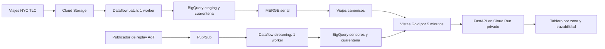

# Lumina — Exposición de datos y demo P3

> Borrador previo. Versión ejecutiva final y tiempos en [guion_ejecutivo_15min.md](guion_ejecutivo_15min.md), con PPTX/PDF en `output/`.

Borrador de contenido para Slides. Fecha: 20/11/2026. Resultados sujetos a la evidencia de `docs/evidencias/demo_final.json`.
No existe aún una presentación nativa de Google Slides verificada. Completar nombres/roles con el equipo.

---

## 1. Resumen ejecutivo y alcance

- Prototipo académico de consulta de movilidad y sensores por zona para apoyar revisión operativa.
- Integración de fuentes heterogéneas, calidad, agregaciones, API y consumidor web.
- Migración de la ejecución local a GCP reproducible con Terraform y Apache Beam.
- Homologación territorial y temporal simulada; no es un sistema de ciudad real.

Notas: mostrar la diferencia entre el caso de negocio propuesto y los efectos económicos todavía no medidos.

---

## 2. Situación actual y observaciones P2

- P2: evidencia basada en capturas, cobertura cloud limitada y falta de instrucciones de reproducción.
- P3: código modular, contratos, SQL, Terraform, pruebas y guion end-to-end.
- Dataflow batch real: 10.000 entradas, 8.459 válidas y 1.541 rechazadas; 255 zonas válidas.
- La muestra es una prueba funcional de un worker; la capacidad masiva requiere otra prueba.

Notas: enlazar `docs/revision_observaciones_p2.md` y el commit publicado antes de entregar.

---

## 3. Criterios de éxito y KPI

| KPI | Fórmula | Meta de demo | Resultado |
|---|---|---|---|
| Contabilidad batch | válidos + rechazados / recibidos | 100% | (8.459 + 1.541) / 10.000 = 100% |
| Cobertura batch válida | zonas distintas | > 1 | 255 |
| Reproceso seguro | viajes después de repetir MERGE − antes | 0 | 0 en ejecución serial |
| Disponibilidad del evento | hora de primera respuesta API − publicación | ≤ 60 s con worker listo | ≈12 s, un caso con worker listo |
| Control de conflictos | IDs de varias versiones excluidos de Gold | 100% del caso inyectado | 1/1; HTTP 409 y exclusión Gold |
| Cierre de cómputo | jobs activos y VMs al finalizar | 0 | 0 jobs / 0 VMs |

Notas: metas propuestas para esta demo, no un SLA ni objetivos aprobados por un cliente.

---

## 4. Productos tecnológicos

- Terraform: recursos, cuentas de servicio, red e IAM.
- Cloud Storage y Pub/Sub: entradas batch y mensajería.
- Apache Beam / Dataflow: validación y distribución de trabajo.
- BigQuery: Silver, cuarentena, deduplicación y vistas Gold.
- FastAPI / Cloud Run: API privada y tablero consumidor.
- Workflows: verificación de conteos bajo demanda.

Notas: no se utiliza Dataproc, Composer ni un clúster Kubernetes propio.

---

## 5. Dependencias, supuestos y alcance

- NYC TLC enero 2024; AoT 2018; referencias históricas 2017.
- Asociaciones territoriales simuladas y desplazamiento de fechas explícito.
- ADC para operadores; cuentas de servicio para ejecución; región única us-central1.
- Fuera de esta entrega: sensores físicos, forecast y agente Vertex, carga masiva, alta disponibilidad y recuperación automática.
- Presupuesto de pruebas y demo: S/50; gasto real NO VERIFICADO.

---

## 6. Arquitectura final

Notas: separar hechos de movilidad y sensores evita multiplicar viajes por cada métrica.
Terraform aprovisiona; el controlador Python opera los jobs; el workflow no orquesta su ciclo de vida.

---

## 7. Calculadora del primer año

- Escenario bajo demanda: 10 h/mes streaming y 10 h/mes batch.
- Escenario continuo: 730 h/mes streaming, sujeto a dimensionamiento.
- Consultas 0,1 TiB/mes, BigQuery 10 GiB medios y Pub/Sub 2 GiB/mes.
- Resultado preliminar: USD 165,27/año bajo demanda; USD 4.037,31/año continuo.
- S/4 por USD es un supuesto; incluye reservas y 30% de contingencia, sin créditos ni free tier.
- SECU, retención y capacidad necesitan calibración; no es una cotización ni gasto observado.

Notas: ejecutar `python3 costs/calculator.py`; fuentes y fórmulas en `costs/README.md`.
No confundir este presupuesto anual con los S/50 de la demo.

---

## 8. Demo batch

- Mostrar el job terminado correctamente y su configuración de un worker privado.
- Contrastar 10.000 recibidos con válidos y cuarentena.
- Ejecutar el MERGE otra vez y comprobar que el total permanece en 8.459 viajes.
- Consultar una zona mediante `/api/metrics`.

Notas: no hace falta volver a procesar el lote durante la defensa; los datos canónicos se conservan.

---

## 9. Demo streaming end-to-end

- Iniciar el proxy autenticado y `scripts/demo_e2e.py`.
- Mostrar Dataflow corriendo, once nodos y la publicación de eventos.
- Buscar el ID de control en el tablero y contrastar publicación, procesamiento y consulta.
- Mostrar duplicado, conflicto HTTP 409 y rechazo no numérico.
- Esperar drain y verificar ausencia de jobs y VMs activos.

Notas: seguir `demo/README.md`; usar un ID nuevo por sesión y distinguir tiempo de arranque de latencia con worker listo.

---

## 10. Resultados y límites

- Pipeline batch ejecutado en Dataflow y resultados expuestos por API Cloud Run.
- Rechazos trazables e idempotencia de consolidación verificada.
- Streaming: 225 mensajes, 41 rechazos y 181 IDs en Gold; disponibilidad observada ≈12 s para un evento con worker listo.
- No se ha medido rendimiento a gran escala ni disponibilidad 24/7.

---

## 11. Conclusiones

- El proyecto conecta ingesta, procesamiento, almacenamiento y aplicación consumidora.
- El código y los contratos permiten repetir las validaciones y auditar el resultado.
- El cierre bajo demanda permite ensayar sin sostener cómputo continuo.
- Los siguientes compromisos dependen de pruebas de capacidad y presupuesto de operación.

---

## 12. Next steps y participación

- Publicar cambios y enlazar un commit concreto; completar Slides nativo y ensayo grupal.
- Medir carga completa, consultas, particiones y retención.
- Automatizar ciclo de vida y recuperación; configurar alertas y CI/CD.
- Migrar estado Terraform a backend GCS privado y compartido.
- Asignar y validar con el equipo quién sustenta negocio, datos, infraestructura y demo.

Notas: responsabilidades individuales NO VERIFICADAS; no atribuir aportes sin confirmación del equipo.
